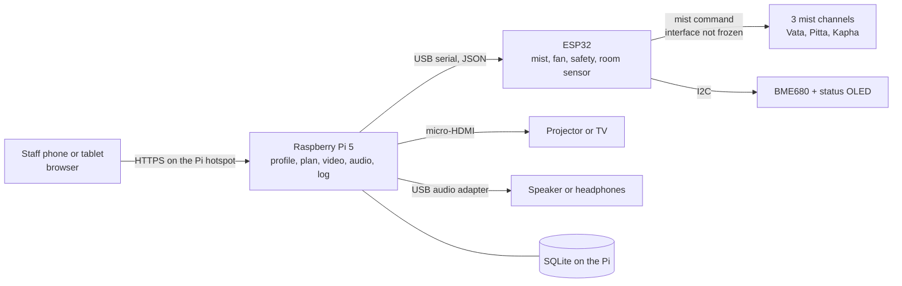
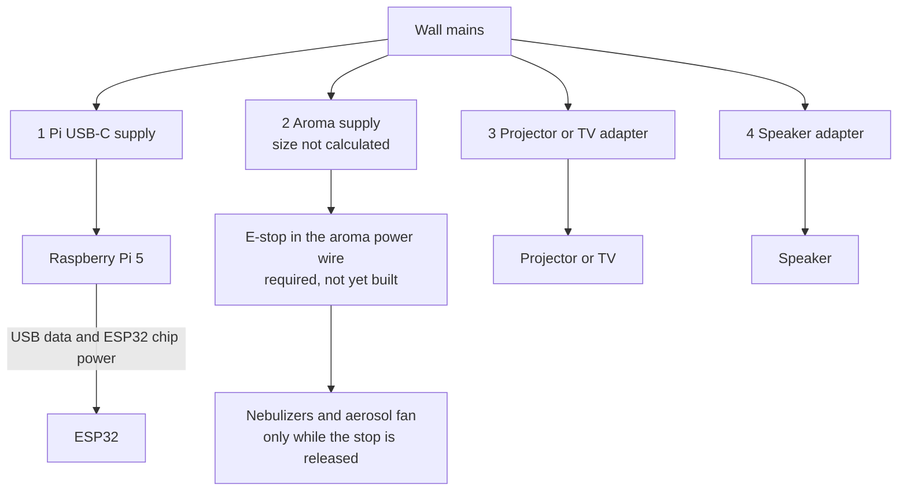
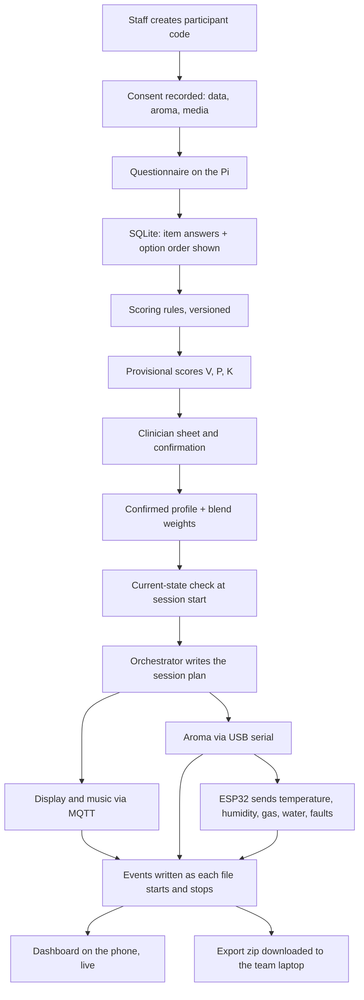

# Prakriti Ayursensora
## System Architecture, Modules, Connections, and Data Flow

**Document status:** Build architecture for Phase I  
**Follows:** `Prakriti_Ayursensora_Problem_Statement_and_Project_Understanding.md`  
**This file answers:** which parts belong to which module, what each part plugs into, which software runs it, and how a session’s data reaches the team.

The 47-line shopping sheet mixed controllers, oils, a treadmill, and consent forms in one total. This file splits the **unit** into six blocks. Every sheet item is placed at the end, so nothing is dropped silently. Parts the sheet never listed, but the wiring needs, are marked **Added**.

Oils, the projector-versus-TV choice, the nebulizer control pin, the fan speed circuit, the ESP32 GPIO map, and the aroma supply size are **not frozen**. No firmware and no wired aroma unit exist in this repository, so none of those circuits has been bench-tested.

---

## 1. The unit in one view

One box in the room. One Raspberry Pi inside it is the brain. One ESP32 is the only board intended to command the mist. How that board switches a nebulizer is not frozen. Staff use a phone or tablet browser. The phone never talks to the ESP32. The ESP32 never joins the hospital Wi-Fi.



| Block | Job | Runs on | Speaks to |
|---|---|---|---|
| **M0 Core** | Store the profile, build the session plan, play media, keep the log | Raspberry Pi 5 | Phone, ESP32, projector, speaker, its own disk |
| **M1 Aroma** | Mist the planned channels, watch water level, leaks, and room air | ESP32 firmware | Pi over USB; mist boards, fan, sensor, buttons over wires |
| **M2 Display** | Play the nature scenes | `mpv` on the Pi | Projector over HDMI |
| **M3 Music** | Play the ragas at a capped volume | `mpv` on the Pi | Speaker over USB audio |
| **M4 Power and enclosure** | Feed the right voltage to each block and cut mist power physically | Mains hardware | Every block |
| **M5 Intake and export** | Questionnaire, clinician confirmation, live screen, files for the team | Web app on the Pi | The research team by a downloaded export |

---

## 2. Software, and where it sits

Phase I uses a local stack. No cloud account is required for a session to run. The existing questionnaire website is optional: if its code is available it can be copied in later. The unit still works if that site is offline.

### 2.1 On the Raspberry Pi 5

| Software | Role |
|---|---|
| **Raspberry Pi OS** 64-bit, current supported image | Operating system. As of 27 October 2026 the current image is Debian 13 (Trixie). Bookworm is the legacy image and is not the baseline. Services start with `systemd`. Confirm FastAPI, SQLite, mpv, HDMI, USB audio, and serial on the image that is actually installed. |
| **Python 3 + FastAPI** | The only program the staff browser talks to. Questionnaire, clinician review, session buttons, export. |
| **SQLite** (WAL mode) | The database. One file on the Pi. Participant code, scores, plans, events, sensor readings, outcome scores. |
| **Orchestrator** (Python service) | Turns a confirmed profile into a session plan. Commands display, music, and the ESP32. Writes the log. |
| **Mosquitto** (MQTT) | Message bus **inside the Pi only**, bound to localhost. Display and music services subscribe here. It is not exposed on the ward network. |
| **mpv** | Plays scene video and raga audio. Two instances: one for picture, one for sound. |
| **ffmpeg** | Used once, offline, to normalize loudness of tracks and to check video files. It does not run during a session. |

Suggested layout on disk:

```text
/opt/ayur/                  application code
/var/lib/ayur/ayur.db       SQLite database
/var/lib/ayur/media/scenes  video files
/var/lib/ayur/media/ragas   audio files
/var/lib/ayur/export        zip files the team downloads
```

### 2.2 On the ESP32

| Software | Role |
|---|---|
| **Arduino-ESP32** firmware, built with **PlatformIO** | Reads commands from USB serial. Commands the aroma outputs once that interface is known. No firmware is in this repository. |
| **ArduinoJson** | Parses one JSON object per line. |
| **Adafruit BME680** and **Adafruit SSD1306** | Room sensor and the small status screen. |

The ESP32 Wi-Fi radio stays off in Phase I. If the USB cable is pulled, or the Pi stops sending a heartbeat, the firmware turns every output off. It stores nothing after power loss.

### 2.3 On the staff phone or tablet

A normal browser (Chrome, Edge, or Safari). No app install. The page is served by FastAPI on the Pi.

### 2.4 What each module depends on

| Module | Software that owns it | Hardware it can touch |
|---|---|---|
| Profile and questionnaire | FastAPI | Database only |
| Session plan and safety gating | Orchestrator | MQTT on localhost, USB serial |
| Aroma | ESP32 firmware | Nebulizer interface, fan, sensor, OLED, stop sense. The driver circuit is not chosen. |
| Display | `ayur-display` + mpv | HDMI |
| Music | `ayur-music` + mpv | USB audio |
| Live view and export | FastAPI | Database, export folder |

The profile service never drives an aroma output. The ESP32 never decides which dosha a person is.

---

## 3. How one session runs

```text
IDLE
  → INTAKE          staff creates a participant code and records consent
  → PROFILE_READY   clinician confirms Vata / Pitta / Kapha
  → PRECHECK        cups, levels, leak sensor, media files, exclusion flags
  → RAMP_IN         short fade-in of picture and music, mist still off
  → RUNNING         all three modules follow the plan
  → WIND_DOWN       mist off first, then picture and music fade
  → ENDED           log closed

From any active state:
  PAUSED    nurse pause or software stop → mist off immediately
  FAULT     leak, dry cup, lost heartbeat, or over-limit → mist off
  SAFE_OFF  hardware e-stop cut the actuator power
```

A failed display or a failed speaker does not turn the others off. Any aroma fault turns **only aroma** off and leaves picture and music running if they are healthy. After a power cut the unit boots to IDLE. Mist never resumes by itself.

---

## 4. M0 — Core (the brain)

### 4.1 Parts

| Qty | Part | Spec to buy or use | Connects to |
|---:|---|---|---|
| 1 | Raspberry Pi 5 | 4 GB is enough for this phase. The sheet’s 8 GB board is acceptable if it is the one already chosen. | Power, USB, HDMI, SD card |
| 1 | Official Pi 5 27 W USB-C supply | 5 V / 5 A with USB-PD. The sheet’s 5 V/10 A SMPS and the 3 A buck modules do not power the Pi. | Mains → Pi USB-C power port |
| 1 | Pi 5 active cooler | Clips onto the Pi. Replaces the loose heatsink-and-paste line for the processor. | Pi thermal pads |
| 1 | microSD, 128 GB, high-endurance | Holds OS, database, scenes, and ragas. The sheet’s 32 GB cards are too small for video. One card starts the work. A cloned spare waits. | Pi SD slot |
| 1 | Official Raspberry Pi RTC battery | Rechargeable ML2020 with the pre-fitted two-pin JST plug, on the Pi 5 RTC connector. A primary CR2032 is the wrong part: the RTC circuit charges the cell. The clock runs while the Pi is powered even without this battery. Fit the official cell when the unit must keep time through a power cut without a network time source. | Pi RTC connector |
| 1 | USB-A to USB-C cable, data-capable | Pi USB port → ESP32. Carries serial data and powers the ESP32 **chip only**. | See M1 |

### 4.2 What the Pi does, and does not do

The Pi runs the web app, the database, the orchestrator, MQTT, video, and audio. It does not drive a nebulizer from its own GPIO. A crash in the media player must not be what turns a piezo on.

### 4.3 Services started on boot

| systemd unit | Process |
|---|---|
| `mosquitto` | Local MQTT broker |
| `ayur-api` | FastAPI on port 443 (HTTPS), LAN and hotspot only |
| `ayur-orchestrator` | State machine, serial link, logger |
| `ayur-display` | mpv for scenes |
| `ayur-music` | mpv for ragas |

---

## 5. M1 — Aroma

Three channels, one per dosha. A dual profile (for example Pitta 55% / Vata 45%) is a **time share** of those channels, not a mix of oils inside one tank. Each cup holds one oil. The blend happens in the room.

### 5.1 Parts

Purchase quantities are in the buy list. This table is the engineering intent, not an order.

| Qty in the concept | Part | What is known | Wiring status |
|---:|---|---|---|
| 1 | ESP32 development board, 38-pin class | Sheet name only. CP2102 and CH340 boards are not the same schematic. No board schematic is in this repository. | USB to the Pi is decided. GPIO map is not frozen. |
| 3 | Ultrasonic nebulizer, 5 V, named ACEBOTT 2.4 MHz on the old sheet | The sheet does not give a model or revision. ACEBOTT’s public page for QB062/QB078 describes a 5 V water humidifier with a falling-edge trigger. That page does not prove the sheet line is that module, does not state a current, and does not approve essential oil. Its sample wiring pin is not an assignment for this project. | **UNRESOLVED.** Match the seller listing to a manufacturer page before buying one sample. Do not assume a MOSFET on the 5 V pin. |
| — | MOSFET and gate resistors | IRLZ44N, 150 Ω, and 10 kΩ were proposals. Infineon’s IRLZ44N on-resistance is specified at gate voltages such as 4 V, 5 V, and 10 V. That is not evidence a 3.3 V ESP32 pin will switch the real load. A module with its own trigger pin may need no power MOSFET. | **UNRESOLVED.** Do not buy a set, and do not assign gate pins, until the nebulizer control method is known. |
| 1 | Fan for a shared outlet | No fan model and no datasheet are in this repository. The fan’s electronics also have to stay out of condensate. That air path is not designed. | **UNRESOLVED — DO NOT FREEZE WIRING.** See §5.3. |
| 3 | Float switch, one per cup | Desired behaviour: an open or unplugged switch means empty. | Parts and pins wait on the reservoir design. |
| 1 | Leak sensor and drip tray | Desired behaviour: a leak forces mist off. | Not built. |
| 3 | Cup, tube, connectors | A shared plenum was sketched. Carry-over between scents is not measured. | **UNRESOLVED** until a cleaning and carry-over check exists. |
| 1 | BME680 | Temperature, humidity, and a gas-sensor signal. | Log only. Not an oil-dose meter and not proof of safe inhalation. |
| 1 | 0.96-inch OLED | Status text. | Optional. Pin not frozen. |
| — | Oils | Names are not signed. | **On hold.** |
| — | Distilled water | Bench fluid only, until the module’s own instructions name an approved fluid. | First bench test. |

### 5.1.1 Fan: speed control is not the emergency cut

Two different jobs were written as one circuit. They are now split.

| Job | What the documents used to say | Status now |
|---|---|---|
| Change fan speed | GPIO 18 to a 4-pin PWM input, and also a MOSFET in the fan’s 5 V path | **UNRESOLVED — DO NOT FREEZE WIRING.** No fan manufacturer or datasheet is in the repository. A 4-wire fan usually wants constant supply power and a separate PWM input. Switching its 5 V with a MOSFET is not the same thing. GPIO 18 is not assigned. |
| Stop the aerosol path in an emergency | E-stop removes actuator power | **Requirement, not a built circuit.** The stop must remove power from the nebulizers and from the fan that pushes mist, without help from the Pi, the ESP32, or USB. The contact rating and the exact conductor are not chosen. |

### 5.2 Wet side and dry side

```text
WET COMPARTMENT
  Cup V ── tube ─┐
  Cup P ── tube ─┼── plenum ── fan ── outlet to the room
  Cup K ── tube ─┘
  drip tray and leak sensor underneath

SEALED BARRIER

DRY COMPARTMENT
  Raspberry Pi, ESP32, any later driver, supplies, OLED
```

Cables that cross the barrier go through glands. The Pi and the ESP32 never sit in the mist path. The shared outlet can hold the previous scent. That carry-over, any backflow, and the cleaning method are **unresolved**. Three cups do not by themselves make three isolated air paths. If a measured purge cannot keep the channels separate, a separate outlet per channel is still an open option. The tube diameter is not chosen.

### 5.3 ESP32 pins — not frozen

No ESP32 board schematic, nebulizer datasheet, or fan datasheet is in this repository. The lines below are status, not a wiring release. GPIO 18, GPIO 5, and GPIO 2 are **not assigned**.

On a classic ESP32, GPIO 0, 2, 5, 12, and 15 are boot-strapping pins, and GPIO 34–39 are input-only and have no internal pull-up. That is why the pause button is no longer on GPIO 5 and the optional lamp is no longer on GPIO 2. A replacement pin is not chosen here, because this repository does not contain the 38-pin board’s pinout.

| Function | Status | Pin in this revision |
|---|---|---|
| USB serial to the Pi | Decided | USB connector. Not a GPIO. |
| Nebulizer on/off | **UNRESOLVED** | None. Wait for the module’s enable or power-input description. |
| Fan speed | **UNRESOLVED — DO NOT FREEZE WIRING** | None. GPIO 18 is withdrawn. |
| Emergency removal of nebulizer and fan power | Requirement | A switch in the power wire. Not a GPIO. Not built and not tested. |
| Pause button | **UNRESOLVED** | None. Removed from GPIO 5. |
| Status LED | **UNRESOLVED** | None. Removed from GPIO 2. |
| Floats, leak, BME680, OLED, e-stop sense contact | Not frozen | None published. Input-only pins need an external bias if they are used later. The sense contact only reports the stop; it does not cut power. |

The piezo is never powered from a GPIO pin. If a later datasheet requires a MOSFET, the gate resistor values are chosen from that MOSFET and that load. 150 Ω and 10 kΩ are not accepted values.

### 5.4 Behaviour required of the aroma controller

These are requirements. There is no firmware in the repository that implements them, and they have not been tested.

1. At boot, mist and the fan that pushes mist stay off until the Pi sends an explicit start.
2. Mist is allowed only while that fan is already running.
3. A lost USB link or a missed heartbeat turns mist and that fan off. The timeout value is not frozen.
4. An open float, a disconnected float wire, or a leak turns mist off.
5. Pressing the e-stop removes power from the nebulizers and from the fan that pushes mist, even if the ESP32 or the Pi is hung.
6. Releasing the stop, rebooting the Pi, rebooting the ESP32, reconnecting USB, or restoring mains does not start mist again. A person must start a new session. A switch that only restores supply voltage does not by itself prove this re-arm. A signal wire must not back-feed a module whose supply has been opened. The DC contact rating and the branch protection are not chosen.
7. The BME680 is logged. Its gas signal is not an interlock and is not a measure of inhaled dose.
8. Any pulse length written in an example is not an exposure limit. Exposure stays on hold until a qualified review sets it.

### 5.5 How the Pi commands aroma

USB serial, 115200 baud, one JSON object per line, with a sequence number and an acknowledgement.

```text
Pi → ESP32   {"seq":42,"cmd":"mist","ch":"P","ms":8000}
ESP32 → Pi   {"ack":42,"ok":true}

Pi → ESP32   {"seq":43,"cmd":"hb"}
ESP32 → Pi   {"ack":43,"ok":true,"temp":26.4,"rh":48.1,"gas":81234,"water":{"V":1,"P":1,"K":1}}
```

Commands the firmware accepts: `mist`, `fan`, `led` (only if the optional strip is fitted), `status`, `stop`, `hb`. Any other command is rejected and logged. A repeated `seq` does not start a second pulse.

The orchestrator owns the schedule. Example for a 15-minute cycle with a 30-second mist budget and weights Pitta 0.55 / Vata 0.45:

```text
Pitta on for about 16.5 s, split into pulses of at most 12 s
Vata  on for about 13.5 s, same rule
Fan starts 5 s before each pulse and runs 20 s after
Kapha channel stays at 0
```

Those seconds are an illustration of time-share only. They are not a bench result and not an exposure limit. Dr. Seema’s review comes before any person uses the unit.

### 5.6 Software on this module

Only the ESP32 firmware. Python decides **how long**. The ESP32 decides **whether that command is still safe**.

---

## 6. M2 — Display

### 6.1 Parts

| Qty | Part | Spec | Connects to |
|---:|---|---|---|
| 1 | Portronics Beem 470, or a 32–43 inch TV | **Open** until the scene is watched in the real room with the lights on. A projector that washes out is replaced by the TV. Either one is the display. | HDMI in, and its **own** mains adapter |
| 1 | micro-HDMI to HDMI cable, 1.5–2 m | **Added.** Pi 5 has micro-HDMI, not full-size HDMI. Use HDMI port 0. | Pi HDMI0 → display |
| 1 | Wall mount or a short tripod | So the beam or screen has a fixed place. | Display only |
| 0 or 1 | WS2812B, 60 LEDs per metre, **1 metre** | Optional colour wash. The sheet’s two 5 m reels are not fitted. Current is not calculated. Not part of the first bench. | Supply and data pin not assigned |
| 1 | 74AHCT125 level shifter, 330 Ω series resistor, 1000 µF capacitor | Only if that optional strip is later fitted. The ESP32 data pin is 3.3 V; a 5 V strip needs a level shift. | No GPIO is assigned. GPIO 13 is not a wiring release. |

### 6.2 Picture path

```text
Session plan → ayur-display → mpv → Pi HDMI0 → cable → projector or TV
```

Files live in `/var/lib/ayur/media/scenes/`. Each file is an MP4, 1920×1080, 24 or 30 fps, a slow 10–20 minute loop, no titles or logos. At least four loops per dosha so a long session does not repeat one clip. Night files are graded darker. Metadata next to each file: dosha, time of day, licence.

A dual profile alternates pools by time share (Pitta scenes, then Vata scenes) at the segment boundaries in the plan. mpv crossfades; it does not hard-cut.

Pi 5 decodes H.265 in hardware and H.264 in software. Encode masters as H.265 if a long session runs the CPU hot; confirm with an 8-hour soak.

### 6.3 Software

`ayur-display` subscribes to `ayur/display/cmd` on localhost MQTT and publishes `ayur/display/status` (playing, paused, fault, file name). It does not choose the file. The plan does.

The projector’s own smart-TV apps and its Bluetooth are left unused. The Pi is the only playback source, so the log knows the file name.

---

## 7. M3 — Music

### 7.1 Parts

| Qty | Part | Spec | Connects to |
|---:|---|---|---|
| 1 | USB stereo audio adapter | **Added.** Pi 5 has no headphone jack. | Pi USB → 3.5 mm out |
| 1 | 3.5 mm cable | Adapter → speaker line-in. | |
| 1 | Powered speaker, about 10 W, with AUX in | The sheet’s speaker. Its Bluetooth pairing is not the ward path. | AUX, and its **own** power (USB or adapter), not the mist rail |
| 1 | Wired headphones or a pillow speaker, plus a splitter | For a shared room, so neighbours are not forced to hear the raga. | Same 3.5 mm output |

### 7.2 Sound path

```text
Session plan → ayur-music → mpv → USB audio adapter → speaker or headphones
```

Tracks live in `/var/lib/ayur/media/ragas/`. Slow instrumental pieces, 20–30 minutes, loudness normalized offline with ffmpeg to one target (starting point −23 LUFS). The player has a software volume ceiling and a lower night ceiling. Those ceilings are **Open** until the clinical team sets them. Measure sound level at the pillow before the first supervised session.

Selection:

```text
pool = tracks whose dosha is in the profile, whose time-of-day tag matches now,
       and which were not just played
pick a dosha with probability equal to its blend weight, then a track from that pool
crossfade about 8–10 seconds
log track id, start, end
```

Raga names in the proposal (Bhimpalasi, Bageshree, Yaman, Kafi, Miyan ki Todi, Malkauns, Marwa, Durga, Bhairav, Jaunpuri, Hamsadhwani, Desh) are the candidate pools. They enter the library only after Dr. Vinayak confirms them, including time-of-day. Recordings are owned, commissioned, or licensed. The Hindi graphic in the deck is not a track list.

### 7.3 Software

`ayur-music` on MQTT topics `ayur/music/cmd` and `ayur/music/status`. Same rule as display: the service plays, the plan chooses.

Binaural beats, if ever tried, need the headphones. The shared speaker cannot deliver them. They are outside Phase I.

---

## 8. M4 — Power, enclosure, and the physical stop

There are **four** power sources. They do not share one 5 V rail. “Three power feeds” was only a count of the three modules and left the Pi supply out.

| Source | Powers | Does not power |
|---|---|---|
| 1. Official Pi 5 USB-C supply | Raspberry Pi 5, and the ESP32 chip through the USB data cable | Nebulizers, fan, projector, speaker |
| 2. Aroma low-voltage supply | Nebulizers and the fan that pushes mist, after the e-stop | Pi, projector, speaker. **Current is not calculated.** A 5 V, 6–7 A figure was a guess and is not a selected supply. |
| 3. Projector or TV adapter | That screen only | The Pi and the aroma rail |
| 4. Speaker adapter | That speaker only | The Pi and the aroma rail |



Until a single enclosure is designed, the display adapter and the speaker adapter can stay outside the aroma box on their own mains plugs. A fused inlet for one shared mains bay is a later mechanical choice, not a reason to mix the four outputs.

**Grounds.** The USB cable already joins Pi ground and ESP32 ground. The aroma supply’s ground joins the ESP32 ground only if the chosen nebulizer or fan interface needs that common reference. Mains protective earth stays on the inlet and on Class I metalwork. It is not assumed to be the same node as logic ground. The projector and the speaker stay on their own adapters, so their secondary circuits are not tied into the aroma rail by this document.

**E-stop, required and not tested.** The stop is a physical break in the power to the nebulizers and to the fan that pushes mist. A GPIO that only reports the button, and a software stop, do not replace that break. With the stop held, those outputs are off. Letting the button go, rebooting either board, reconnecting USB, or restoring power does not start mist. Restoring the 5 V rail is not a start command. No test record of this exists, and no contact rating has been chosen.

There is no 18650 pack and no power bank in this phase. If mains fails, mist, picture, and sound go off, and the next boot is IDLE. The pause button has no GPIO yet. The enclosure is not ordered until the wet path has a measured layout. Breadboards are for the bench, not for the finished liquid path.

The Pi is the only computer on the network side. An 8-port switch is not part of the unit. The Pi serves a Wi-Fi hotspot named for the unit. Staff join that hotspot. If a site forbids a hotspot, a single travel router is added later; the ESP32 still stays on the USB cable.

---

## 9. M5 — Intake, live view, and how data reaches the team

### 9.1 Who looks at what

| Person | Screen | What they do |
|---|---|---|
| Staff or nurse | Phone browser → Pi | Enrol, start, pause, stop, read faults |
| Clinician | Same site, clinician role | Review scores, confirm the label |
| Build and research team | Same site, or a downloaded zip | Session history, sensor trace, export |

Roles: clinician, technician, admin. The technician sees module health and logs. The clinician sees the profile. Names and phone numbers are not fields on the Pi. The hospital keeps a paper or hospital-system map from the real identity to the participant code.

### 9.2 Path of a person’s data



Nothing in that path needs the public internet. The existing website is a second door only: if it can export a score file, the Pi can import that file. The default door is the form hosted on the Pi, so a session does not depend on the website staying up.

### 9.3 What is stored

| Table | What it holds | Example of a row |
|---|---|---|
| `participants` | Code, age band, language, consent id. No name. | `P-0457` |
| `consents` | Version, time, scope, withdrawal | aroma allowed, media allowed |
| `responses` | Each answer, the order the options were shown, form version | item 12 → Pitta |
| `clinician_assessments` | Clinician’s own V/P/K percent and final label | Pitta–Vata |
| `prakriti_results` | Rule version, self scores, clinician scores, final scores, label, blend weights, flags | `scoring_v1.0`, weights P 0.55 / V 0.45 |
| `vikriti_checks` | The short “how are you now” answers for this session | separate from Prakriti |
| `sessions` | Code, study arm, plan JSON, start, end, stop reason, operator | `personalized`, 60 min |
| `events` | Time, module, type, payload | `scene_start`, `forest_04` |
| `env_readings` | Time, temperature, humidity, gas resistance | from BME680 |
| `outcomes` | PSS, HADS, PSQI at a timepoint, entered by the clinical team | not used to drive the hardware |
| `content_catalog` | File id, dosha, time of day, licence | scene or raga |
| `oil_catalog` | Oil, batch, cautions | checked before PRECHECK |
| `audit_log` | Who confirmed, who started, who exported | |

Study arm on the session is `personalized`, `generic`, or `mismatched`. The orchestrator uses it when it builds the plan. Assignment and blinding stay with the clinical team.

### 9.4 The session plan, the one object every module shares

```json
{
  "session_id": "S-2026-000123",
  "patient_code": "P-0457",
  "arm": "personalized",
  "profile": {
    "type": "dual",
    "primary": "P",
    "secondary": "V",
    "weights": { "V": 0.45, "P": 0.55, "K": 0.0 },
    "scoring_version": "scoring_v1.0"
  },
  "intensity": "L1",
  "duration_min": 60,
  "aroma":   { "cycle_min": 15, "budget_s": 30, "channels": { "P": 0.55, "V": 0.45 } },
  "display": { "segments": [ {"t": 0, "scene_pool": "P"}, {"t": 20, "scene_pool": "V"} ] },
  "music":   { "pools": { "P": 0.55, "V": 0.45 }, "volume_cap": 0.35 }
}
```

The ESP32 receives mist commands derived from `aroma`. It does not receive the questionnaire.

### 9.5 How the data gets to the team

| When | What you see | Where it lives |
|---|---|---|
| During the session | Phone dashboard: state, which scene, which track, which channel is on, temperature, humidity, faults | Browser, read from the Pi |
| End of the day | Button **Export study pack** | A zip written on the Pi, then copied to the team laptop (USB stick or a download on the hotspot) |
| Later analysis | Harshali’s analysis and Seema’s outcome tables | Those CSV files. The Pi is the source. |

The zip contains:

| File | Contents |
|---|---|
| `participants.csv` | Codes, age band, language. No names. |
| `prakriti_results.csv` | Scores, label, weights, rule version, who confirmed |
| `sessions.csv` | Plan, arm, start, end, stop reason |
| `events.csv` | Every scene, track, mist pulse, pause, fault |
| `env_readings.csv` | BME680 trace |
| `outcomes.csv` | PSS, HADS, PSQI when the clinical team has entered them |
| `manifest.json` | Export time, software version, rule version |

The identity map (code ↔ person) stays at the hospital and is not inside this zip. Camera video and fingerprints are not collected in this phase, so they are not in the export.

MQTT topics used on localhost:

| Topic | Direction | Carries |
|---|---|---|
| `ayur/session/start`, `stop`, `pause` | Orchestrator → display and music | The plan, or the reason |
| `ayur/display/cmd`, `status` | Orchestrator ↔ display service | Scene file, state |
| `ayur/music/cmd`, `status` | Orchestrator ↔ music service | Track, volume, state |
| `ayur/safety/event` | Orchestrator, from serial | estop, leak, low water |

Aroma does not use MQTT. Aroma uses the USB serial link, and the orchestrator copies those lines into `events` and `env_readings`.

---

## 10. Every connection, in one list

| # | From | To | Cable or bus | What travels |
|---|---|---|---|---|
| 1 | Wall socket | Pi 27 W supply | Its own mains lead | Source 1 |
| 2 | Pi supply | Raspberry Pi 5 | USB-C | Pi power. Official 5 V / 5 A negotiation. |
| 3 | Wall socket | Aroma supply | Its own mains lead | Source 2. Current not calculated. |
| 4 | Aroma supply | E-stop | Low-voltage pair | Required break. Not built. |
| 5 | E-stop | Nebulizers and the fan that pushes mist | Power pair | Off while the stop is held. Conductor not chosen. |
| 6 | Wall socket | Projector or TV adapter, and speaker adapter | Two further mains leads | Sources 3 and 4. Not the aroma rail. |
| 7 | Pi USB | ESP32 USB | Data USB cable | Serial JSON; chip power for the ESP32 |
| 8 | Aroma supply, through the e-stop | Nebulizers and the fan that pushes mist | Power pair | **Requirement.** The conductor and the supply current are not chosen. |
| 9 | ESP32 | Nebulizer control pin | Unknown until the datasheet | **UNRESOLVED.** Not GPIO 25/26/27. |
| 10 | ESP32 | Fan speed input | Unknown until the fan datasheet | **UNRESOLVED.** Not GPIO 18. Not a MOSFET in place of PWM. |
| 11 | Float, leak, BME680, OLED, pause, lamp | ESP32 | Not assigned | Pins withdrawn until the board schematic exists. |
| 15 | Pi HDMI0 | Projector or TV | micro-HDMI to HDMI | Video |
| 16 | Projector or TV | Its own adapter | Mains | Display power |
| 17 | Pi USB | USB audio adapter | USB | Digital audio |
| 18 | Audio adapter | Speaker AUX or headphones | 3.5 mm | Analog audio |
| 19 | Speaker | Its own adapter | Mains or USB | Speaker power |
| 20 | Staff phone | Pi hotspot | Wi-Fi, HTTPS | Pages and the export download |
| 12 | Optional LED strip | Not assigned | — | Not part of the first bench. No data pin is chosen. |

There is no Ethernet switch in this list, no relay board, no L298N, no second computer, and no battery.

---

## 11. Where the 47 sheet lines went

Prices stay the sheet’s prices. They are not a new quotation.

| Sheet | Item | Qty on sheet | Placed in | Decision |
|---:|---|---:|---|---|
| 1 | Raspberry Pi 5, 8 GB, ₹19,618 | 1 | M0 | **Keep** as the brain. 4 GB is enough if you re-quote. |
| 2 | Arduino Uno R4 WiFi, ₹1,598 | 1 | — | **Leave out.** The ESP32 is the actuator. |
| 3 | L298N, ₹146 | 1 | — | **Leave out.** No replacement driver is selected. |
| 4 | ESP32 5-inch touch, ₹3,832 × 2 | 2 | — | **Leave out.** The phone browser is the screen. |
| 5 | ESP32 dev board, ₹355 | 1 | M1 | **Keep**, and add a spare. |
| 6 | microSD 32 GB, ₹749 × 2 | 2 | M0 | **Change** to 128 GB high-endurance, plus a spare image. |
| 7 | Ultrasonic nebulizer, ₹850 × 3 | 3 | M1 | **Keep**, add one spare after the bench test confirms this module. |
| 8 | 5 V 80 mm fan, ₹98 × 3 | 3 | M1 | One shared outlet is the intent. The fan’s electrical interface is **not frozen**. |
| 9 | 4-channel relay, ₹143 × 2 | 2 | — | **Leave out.** |
| 10 | Helichrysum, tagged Vata/Pitta, ₹450 × 10 | 10 | M1 | **Hold.** Not in the slide mapping. |
| 11 | Davana, tagged Vata/Kapha, ₹610 × 10 | 10 | M1 | **Hold.** |
| 12 | Tea tree, tagged Pitta/Kapha, ₹300 × 10 | 10 | M1 | **Hold.** |
| 13 | Tridoshic / Sama oil, ₹499 × 10 | 10 | M1 | **Hold.** |
| 14 | 30 ml dropper bottles, ₹9 × 9 | 9 | M1 | **Keep** for storage of the signed oils. |
| 15 | AS608 fingerprint, ₹879 | 1 | — | **Later.** Phase I uses a participant code. |
| 16 | Arducam IMX219, ₹3,568 | 1 | — | **Later.** The deck already allows a phone in place of the camera. |
| 17 | 7-inch touchscreen, ₹6,333 | 1 | — | **Leave out** of Phase I. Browser on a phone. |
| 18 | 5 V / 10 A SMPS, ₹585 | 1 | M4 | **Change role.** Do not run the Pi, the LEDs at full white, and the mist from this one box. Actuator rail is a separate enclosed 5 V supply. Pi has its own 27 W supply. |
| 19 | 25,000 mAh power bank, ₹4,899 | 1 | — | **Leave out** of Phase I. |
| 20 | 18650 cells, ₹375 × 4 | 4 | — | **Leave out.** No loose lithium pack in the ward unit. |
| 21 | 5 V / 3 A buck, ₹48 × 2 | 2 | — | **Leave out.** No 12 V source exists for them, and 3 A is low for a Pi 5. |
| 22 | Beem 470 projector, ₹7,997 | 1 | M2 | **Candidate.** Buy after the room light test. |
| 23 | 10 W speaker, ₹499 | 1 | M3 | **Keep**, wired to AUX. |
| 24 | WS2812B 5 m, ₹2,594 × 2 | 2 | M2 | **Change** to 1 metre, optional. Two full reels need on the order of tens of amps at full white. |
| 25 | OLED 0.96-inch, ₹219 × 3 | 3 | M1 | **Change** to one. These displays share only two I²C addresses. |
| 26 | MAX30100, ₹107 | 1 | — | **Later.** |
| 27 | BME680, ₹836 × 2 | 2 | M1 | **Change** to one, on the ESP32. |
| 28 | GSR sensor, ₹800 × 2 | 2 | — | **Later.** |
| 29 | MAX30102, ₹114 × 2 | 2 | — | **Later.** |
| 30 | Acrylic enclosure, ₹2,000 | 1 | M4 | **Redesign** into wet and dry compartments after the bench layout. |
| 31 | 3D-printed brackets, ₹1,200 × 10 | 10 | M4 | **Rebuild** the set that the bench layout actually needs. |
| 32 | ABS project box, ₹450 | 1 | M4 | **Optional** dry-side box if the main enclosure is not ready. |
| 33 | Heatsinks and paste, ₹250 × 2 | 2 | M0 | **Change** to the Pi 5 active cooler. |
| 34 | Jumper wires, ₹186 × 3 | 3 | Bench | **One set** for the bench, not the finished loom. |
| 35 | Breadboard, ₹61 × 2 | 2 | Bench | **One** for bring-up. Finished unit uses a perfboard. |
| 36 | Custom PCB, ₹2,500 | 1 | — | **Later**, after the wiring has been stable. |
| 37 | Soldering kit, ₹1,750 | 1 | Tools | **Keep** if you do not already own one. |
| 38 | USB cable set, ₹599 | 1 | M0, M2 | **Keep**, and add the specific micro-HDMI and data USB cables in Section 10. |
| 39 | 8-port network switch, ₹800 | 1 | — | **Leave out.** Pi hotspot. |
| 40 | Consent forms, 300 × ₹5 | 300 | M5 | **Keep** as paper. Not a wire. |
| 41 | Stationery, ₹1,500 | 1 | Admin | **Keep.** |
| 42 | Software and cloud, ₹5,000 | 1 | M0 | **Optional.** The Phase I stack is open source and local. |
| 43 | Transport, ₹4,000 | 1 | Admin | **Keep.** |
| 44 | Publication, ₹10,000 | 1 | Admin | **Keep** in the programme budget, outside the unit. |
| 45 | Contingency, ₹28,145 | 1 | Admin | **Recompute** on the revised unit, not on the lines you are leaving out. |
| 46 | Treadmill, ₹17,998 | 1 | — | **Outside this unit.** It connects to none of the three modules. |
| 47 | Student coordinator, ₹50,000 | 1 | People | **A person, not a part.** Keep it on a personnel line if the programme still wants it. |

Sheet total printed on the page: **₹2,27,766**. That number includes the treadmill, the coordinator, relays, extra boards, and oils that are on hold. It is not the cost of the connected unit in this document.

---

## 12. Parts the sheet did not contain, which the connections need

| Part | Why it exists | Block |
|---|---|---|
| Official Pi 5 27 W USB-C supply | The Pi 5 needs a negotiated 5 V / 5 A source | M0 |
| USB data cable, Pi → ESP32 | The only aroma command path | M0–M1 |
| micro-HDMI to HDMI cable | Pi 5 video out | M2 |
| USB audio adapter and 3.5 mm lead | Pi 5 has no audio jack | M3 |
| Official Pi 5 RTC battery, ML2020 with JST plug | Timekeeping through a power cut when no network time source exists. A primary CR2032 is the wrong cell. | M0 |
| Active cooler | Pi 5 thermal path | M0 |
| 128 GB high-endurance microSD | Video and audio library | M0 |
| Nebulizer control parts | Only after the module datasheet names an enable pin or a switched supply. Resistor values are not chosen. | M1 |
| Float switches, leak sensor, drip tray | Stop a dry piezo and catch a spill | M1 |
| Cups, silicone tube, connectors, plenum | The three channels have to reach one outlet | M1 |
| Aroma low-voltage supply, current still uncalculated | Separate from the Pi. The old 6–7 A guess is not a selected part. | M4 |
| Shared mains inlet | Only if one enclosure later holds all four adapters. Not required for the bench. | M4 |
| E-stop | Physical break in aroma actuator power. Required, not built, not tested. | M4 |
| Pause button | No pin assigned. It is not a substitute for the e-stop. | M4 |
| 74AHCT125, 330 Ω, 1000 µF | Only if the 1 m LED strip is fitted | M2 |
| Staff phone or tablet | Already in someone’s pocket; the UI | M5 |
| Multimeter | Bench current. Buy or use one already owned. | Tools |
| 0.01 g scale | Optional mass-loss check. Borrow first. Mass loss is not an inhaled dose. | Tools |

---

## 13. Still open

| Item | Who closes it | What stays the same while you wait |
|---|---|---|
| Oil names and the dual-dosha cut-offs | Dr. Vinayak | Three cups in the concept, weights in the plan. The switching circuit is not chosen. |
| Maximum mist time, night volume, night brightness, who is excluded | Dr. Seema | Firmware caps and the software volume ceiling are configuration |
| Projector versus TV | Room light test | HDMI from the Pi either way |
| Water-based ultrasonic mist versus a waterless nebulizer, and whether the chosen module accepts oil | The module’s datasheet, then a water-only bench test | The Pi can still send a `mist` command. The wire that acts on it is not chosen. |
| Whether the old website’s code is reused | Whoever has the repository | The Pi hosts the form until then |

---

## 14. Bring-up order

Build in this order so a later module cannot hide a fault in an earlier one.

1. Pi boots, hotspot comes up, a phone opens the empty web page, the database file exists.
2. USB serial: the Pi sends `hb` and the ESP32 answers. A lost cable must leave the aroma outputs off. There is no assigned lamp pin for this check.
3. One nebulizer, water only, on a current-limited bench supply, with the physical e-stop in that supply. The fan is added only after its datasheet exists. Mass loss is recorded as mass loss, not as an inhaled dose.
4. A second and third channel wait until the first module’s control pin, current, and fluid limits are known. Then the wet/dry box.
5. One scene over HDMI. One raga over the USB audio adapter. Volume measured at the pillow.
6. One plan JSON runs all three, writes `events`, and the export zip opens on a laptop.
7. Pull USB, press e-stop, and cut mains, each on purpose. Mist stays off afterwards.
