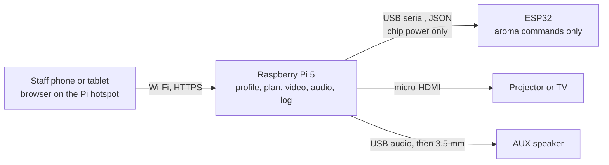

# Prakriti Ayursensora
## Components and how they connect

**Status of this list:** How the modules connect. Quantities, phases, and the check of batteries, converters, resistors, transistors, and connectors are in `Prakriti_Ayursensora_Final_Buy_List.md`. The aroma models, pins, and supply current are **not** frozen. This page is not approval for use around people.

The three modules do not cable to each other. Each one meets the Raspberry Pi. The phone talks only to the Pi.

---

## 1. System chart



```text
Wall mains
  ├─ 1  Official Pi 27 W USB-C supply  →  Raspberry Pi 5  →  ESP32 chip (USB)
  ├─ 2  Aroma supply, current unknown  →  physical e-stop  →  nebulizers and aerosol fan
  ├─ 3  Projector or TV adapter        →  that screen only
  └─ 4  Speaker adapter                →  that speaker only
```

| Link | From | To | What travels | Frozen? |
|---|---|---|---|---|
| Staff control | Phone browser | Pi hotspot | Pages, start, pause, stop, export | Yes. The phone never reaches the ESP32. |
| Aroma command | Pi USB port | ESP32 USB port | JSON on a data cable. Chip power for the ESP32. | Yes. Actuator power does not come from this cable. |
| Picture | Pi HDMI port 0 | Projector or TV | Video | Yes. The screen is still chosen after a room light test. |
| Sound | Pi USB port | USB audio adapter, then 3.5 mm | Audio | Yes. |
| Aroma power | Aroma supply, through the e-stop | Nebulizers and the fan that pushes mist | Low-voltage power | The path is required. The supply size and the wires are not chosen. |
| Inside aroma | ESP32 | Nebulizer, fan, sensors | Control and sense signals | **Not frozen.** No GPIO is assigned. |

---

## 2. Shared core

These parts are not a fourth module. Every module plugs into them.

| Qty | Part | Exact detail | Connects to | Status |
|---:|---|---|---|---|
| 1 | Raspberry Pi 5, 4 GB | One board. An 8 GB Pi 5 is used only if that board is already on hand. | Official supply, microSD, RTC battery, USB, HDMI | `BUY NOW` |
| 1 | Official Raspberry Pi 27 W USB-C supply | 5 V / 5 A with USB Power Delivery. Source 1 of four. | Wall mains → Pi USB-C power port | `BUY NOW` |
| 1 | Raspberry Pi 5 active cooler | The official clip-on cooler for this board. | On the Pi | `BUY NOW` |
| 1 | 128 GB high-endurance microSD | One boot card for the OS, database, scene videos, and raga audio. A spare card waits. | Pi microSD slot | `BUY NOW` |
| 1 | Official Raspberry Pi RTC battery | Rechargeable ML2020 with the pre-fitted two-pin JST plug. A primary CR2032 is the wrong cell. | Pi 5 RTC connector | `BUY NOW` |
| 1 | Phone or tablet already on hand | A normal browser. No app. | Pi hotspot over Wi-Fi | Already owned |

Software on the Pi, once installed and tested: the current supported Raspberry Pi OS 64-bit (Debian 13 Trixie as of 27 October 2026), FastAPI, SQLite, mpv, and Mosquitto bound to localhost. Bookworm is the legacy image. None of this software is in the repository yet.

---

## 3. Module 1 — Aroma

The Pi sends a mist plan. The ESP32 is the only board intended to act on it. How that board turns a nebulizer on is unknown until the exact module’s instructions are in hand.

| Qty | Part | Exact detail | Connects to | Status |
|---:|---|---|---|---|
| 1 | ESP32 development board | One board for USB-serial bring-up. Record the exact seller listing and keep that board’s schematic. CP2102 and CH340 boards are not the same pinout. | Pi, by the data cable below | `BUY NOW` |
| 1 | USB data cable | Matched to the ESP32 connector. Must carry data. Powers the ESP32 chip only. | Pi USB-A → ESP32 | `BUY NOW` |
| 1 | Ultrasonic nebulizer candidate | Order one only after the seller’s model and revision match a manufacturer page and its allowed fluid. The old sheet says “ACEBOTT, 2.4 MHz” and does not name a revision. ACEBOTT’s public QB062/QB078 page is a water-humidifier lead, not proof of that sheet line. | Its own supply and its documented control pin. Pin number not assigned. | `BENCH-TEST FIRST` |
| 1 | Current-limited 5 V bench supply | Limit set from that module’s specification. This is not a 5 V 6–7 A enclosed supply. | One nebulizer, through the stop switch | `BENCH-TEST FIRST` |
| 1 | Stop switch | Buy only after its DC contact rating covers the measured current. A physical break in the actuator feed. Releasing it does not start mist. | In series with the nebulizer supply | `BENCH-TEST FIRST` |
| — | Distilled water | Test fluid only when the module’s own instructions allow water. | In the test cup | `BENCH-TEST FIRST` |
| 2 | Further nebulizers | The concept is three channels: Vata, Pitta, Kapha. Channels 2 and 3 wait on the first unit. | Same class of interface as the first, once that interface is known | `WAIT FOR APPROVAL` |
| — | Driver parts (MOSFET, 150 Ω, 10 kΩ) | Not selected. A trigger pin on the module may make a power MOSFET unnecessary. IRLZ44N on-resistance is not specified at 3.3 V. | Nowhere, until a datasheet requires them | `WAIT FOR APPROVAL` |
| 1 | Fan or blower | No model. Speed wiring is **UNRESOLVED — DO NOT FREEZE WIRING**. GPIO 18 is not assigned. The motor stays out of condensate. | Aroma supply, after the e-stop, once a datasheet exists | `WAIT FOR APPROVAL` |
| 3 | Float switches | One per cup, after the cup shape exists. An open wire is intended to mean empty. | ESP32 inputs. Pins not assigned. | `WAIT FOR APPROVAL` |
| 1 | Leak sensor and drip tray | After the wet layout exists. | ESP32. Pin not assigned. | `WAIT FOR APPROVAL` |
| 3 | Cups, tube, connectors | Diameter not chosen. A shared outlet can carry scent from one channel into the next. A separate outlet per channel stays open if a purge cannot prevent that. | Nebulizer → outlet | `WAIT FOR APPROVAL` |
| 1 | BME680 | Temperature, humidity, and a gas signal for the log. It is not an oil-dose meter. | ESP32 I²C, after a pin check. Keep it out of droplets. | `WAIT FOR APPROVAL` |
| 1 | 0.96-inch OLED | Optional status text. | Same I²C bus, after a pin check | `WAIT FOR APPROVAL` |
| — | Essential oils and dropper bottles | Names and exposure are unsigned. | Not purchased | `WAIT FOR APPROVAL` |
| 1 | Enclosed aroma supply | Current is not calculated. Includes any 5 V 6–7 A guess. | Mains → e-stop → actuators. Source 2 of four. | `WAIT FOR APPROVAL` |
| 1 | Pause button | No GPIO. GPIO 5 is withdrawn because it is a boot-strapping pin. | ESP32, after a safe pin is chosen on the exact board | `WAIT FOR APPROVAL` |

Aroma connection, as far as it is known:

```text
Pi USB  ---- data + ESP32 chip power ----  ESP32
                                              |
                                              |  control wire: UNKNOWN
                                              v
Aroma supply -- e-stop -- nebulizer power     nebulizer
                 |
                 +-------- aerosol-fan power   fan     (fan model unknown)
```

GPIO 18, GPIO 5, GPIO 2, and GPIO 13 are not assigned. GPIO 25, 26, and 27 are not nebulizer gates.

---

## 4. Module 2 — Display

The Pi plays the video. There is no second computer in this module.

| Qty | Part | Exact detail | Connects to | Status |
|---:|---|---|---|---|
| 1 | micro-HDMI to HDMI cable | Pi 5 video output is micro-HDMI. Use HDMI port 0. Choose the length after the screen position is known. | Pi HDMI0 → projector or TV HDMI input | `BUY NOW` |
| 1 | Projector or a TV | Portronics Beem 470 is a candidate only. Choose after the real scene is watched at the real size and room light. | Its own mains adapter. Source 3 of four. | `WAIT FOR APPROVAL` |
| 1 | Screen mount or a short stand | After the screen is chosen. | The screen only | `WAIT FOR APPROVAL` |
| — | Scene video files | MP4 loops on the Pi card, under `/var/lib/ayur/media/scenes/`. | Read by mpv on the Pi | Files, not a purchase |
| 0 | LED strip | Optional colour wash. Not required for the picture. Current and data pin are not chosen. | Not connected | `OMIT` for this phase’s first build |

```text
Session plan on the Pi → mpv → HDMI0 → micro-HDMI cable → projector or TV
Projector or TV  ←  its own adapter  ←  wall mains
```

---

## 5. Module 3 — Music

The Pi plays the audio. The Pi 5 has no headphone socket, so the sound leaves through USB.

| Qty | Part | Exact detail | Connects to | Status |
|---:|---|---|---|---|
| 1 | USB audio adapter | A USB Audio Class device that Linux can see. Confirm the ALSA device after the OS is installed. | Pi USB port | `BUY NOW` |
| 1 | 3.5 mm audio cable | Stereo, both ends male unless the speaker needs another plug. | Adapter output → speaker AUX input | `BUY NOW` |
| 1 | Powered speaker, about 10 W, with AUX | Enough for a bench playback check. It is not a chosen clinical-room speaker. | AUX in, and its own adapter. Source 4 of four. | `BUY NOW` |
| — | Raga audio files | On the Pi card, under `/var/lib/ayur/media/ragas/`. Names stay unsigned. | Read by mpv on the Pi | Files, not a purchase |
| 1 | Headphones | After the shared-room volume decision. They use the same 3.5 mm output. | In place of the speaker | `WAIT FOR APPROVAL` |

```text
Session plan on the Pi → mpv → USB audio adapter → 3.5 mm cable → speaker AUX
Speaker  ←  its own adapter  ←  wall mains
```

---

## 6. Power and grounds

| Source | Powers | Stays off this source |
|---|---|---|
| 1. Pi 27 W USB-C supply | Raspberry Pi 5, and the ESP32 chip through the USB data cable | Nebulizers, fan, projector, speaker |
| 2. Aroma supply | Nebulizers and the fan that pushes mist, and only after the e-stop | Pi, projector, speaker. Amperage not calculated. |
| 3. Display adapter | Projector or TV | Pi and the aroma rail |
| 4. Speaker adapter | Speaker | Pi and the aroma rail |

The USB cable joins Pi ground and ESP32 ground. The aroma supply’s ground joins the ESP32 ground only if the chosen nebulizer or fan interface needs that shared reference. Mains earth is the protective earth of the adapters. It is a separate matter from the logic ground. Display and speaker adapters stay on their own plugs until an enclosure is designed.

The e-stop is a required break in source 2. It is not built and not tested. With it held, the nebulizers and the aerosol fan are off. Letting it go, rebooting the Pi or the ESP32, reconnecting USB, or restoring mains does not start mist.

---

## 7. Full connection list

| # | From | To | Cable | Status |
|---:|---|---|---|---|
| 1 | Wall socket | Pi 27 W supply | Mains lead supplied with the official PSU | Frozen |
| 2 | Pi supply | Raspberry Pi 5 | USB-C | Frozen |
| 3 | Pi microSD slot | 128 GB card | The card itself | Frozen |
| 4 | Pi RTC connector | Official ML2020 battery | Pre-fitted JST plug | Frozen |
| 5 | Pi USB | ESP32 USB | Data cable matched to the board | Frozen as the command path |
| 6 | Pi HDMI0 | Projector or TV | micro-HDMI to HDMI | Cable frozen. Screen waiting. |
| 7 | Projector or TV | Its adapter | That product’s lead | Waiting on the screen choice |
| 8 | Pi USB | USB audio adapter | USB plug on the adapter | Frozen |
| 9 | USB audio adapter | Speaker AUX | 3.5 mm | Frozen |
| 10 | Speaker | Its adapter | That product’s lead | Frozen for the bench speaker |
| 11 | Staff phone | Pi hotspot | Wi-Fi | Frozen |
| 12 | Wall socket | Aroma supply | Mains lead of a supply not yet chosen | Waiting |
| 13 | Aroma supply | E-stop | Low-voltage pair | Required, not built |
| 14 | E-stop | Nebulizer, and later the aerosol fan | Power pair | Required, not built |
| 15 | ESP32 | Nebulizer control pin | Unknown until the datasheet | **Not frozen** |
| 16 | ESP32 | Fan speed input | Unknown until the fan datasheet | **Not frozen** |
| 17 | Floats, leak, BME680, OLED, pause | ESP32 | Not assigned | **Not frozen** |

There is no cable from aroma to the projector, and no cable from the projector to the speaker.

---

## 8. Left out of this phase

| Item | Status |
|---|---|
| Arduino Uno, L298N, relay boards | `OMIT` |
| Two 5-inch ESP32 touch boards, fingerprint reader, camera, 7-inch touch screen | `OMIT` |
| Power bank, 18650 cells, buck converters | `OMIT` |
| Network switch | `OMIT` |
| Heart-rate and skin-conductance sensors | `OMIT` |
| Two full LED reels, extra OLEDs, a second BME680 | `OMIT` |
| A fan MOSFET bought as the speed-control method | `OMIT` |
| Custom PCB | `OMIT` |
| Treadmill | `OMIT` |

The student coordinator is a person, not a component. The old sheet total of ₹2,27,766 is not the cost of this list.

---

## 9. What to buy in which order

1. **Now:** the shared-core rows marked `BUY NOW`, one ESP32, one data cable, the HDMI cable, the USB audio adapter, the 3.5 mm cable, and one AUX speaker.
2. **After the nebulizer model is identified:** one nebulizer, distilled water if its instructions allow water, a current-limited bench supply, and a stop switch whose DC rating covers the measured current.
3. **After that bench:** the fan, channels 2 and 3, the enclosed aroma supply, oils, the screen, and the enclosure. Each of those still needs the evidence named in its row.
